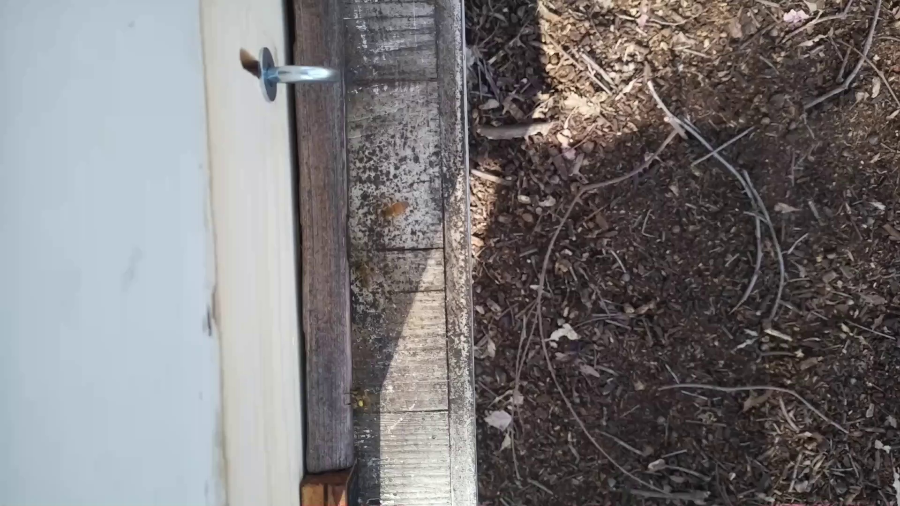
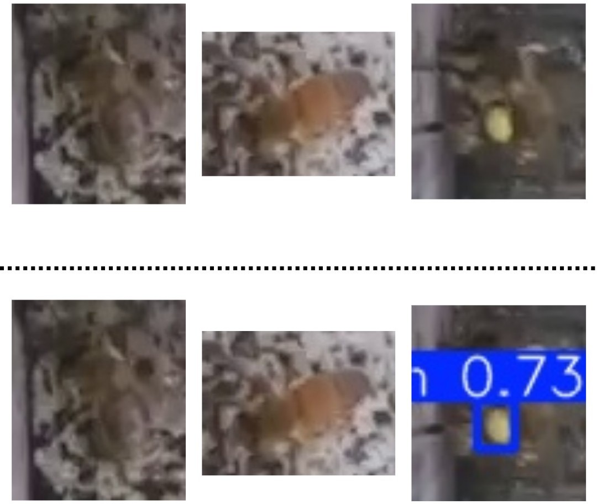
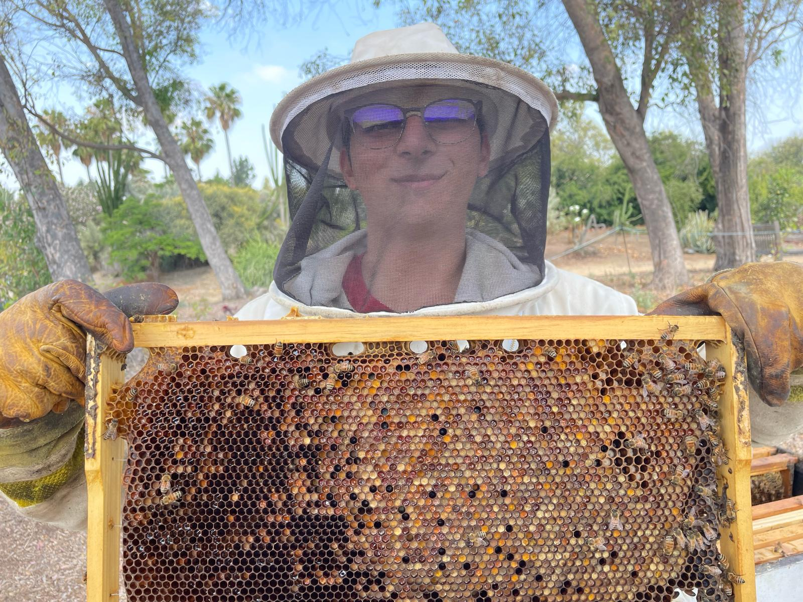

# Beyond Single-Shot Detection: Overcoming Spatial Resolution Bottlenecks in Pollen Identification 
**Published Research:** Kshitij Pingle, Marwan Ahmed, Kanika Sood, Jin Woo Lee, Sara Johnson. "Beyond Single-Shot Detection: Overcoming Spatial Resolution Bottlenecks in Pollen Identification." IEEE AIIoT 2026. DOI: [https://doi.org/10.1109/AIIoT68874.2026.11569627](https://doi.org/10.1109/AIIoT68874.2026.11569627)  

**Awards:** 1st Place (Interdisciplinary) & AI-Enabled Award — 40th CSU Student Research Competition (San Jose State University, competing against 23 universities)  

## Table of Contents  
- Overview
- Motivation & Background
- Related Works
- Detection Pipeline
- Visual Results
- Hardware & Camera System
- Recording Pipeline
- Dataset & Labelling
- The Spatial Resolution Bottleneck
- Two-Stage Hierarchical Detection Architecture
- Context-Aware Cropping
- Coordinate Transform Function
- Pollen Estimation
- Model Performance
- Tech Stack
- Future Work
- About the Researcher
- Acknowledgments
- Publication

## Overview  
This project presents a **Two-Stage Hierarchical Detection Pipeline** for automated honeybee pollen foraging monitoring. Rather than relying on a single object detection model, the system first detects honeybees in full-resolution frames and then applies a second specialized model to detect pollen sacs on the agent-centric cropped bee regions. This strategy resolves a spatial resolution bottleneck that prevented single-shot YOLOv8n models from reliably detecting tiny pollen sacs in dense 1920×1080 pixel frames, boosting mAP@50 from 0.260 to **0.931** on unseen test data.  

The five core contributions of this work are:  
1. Design and deploy a **modular, weatherproof, solar-powered camera system** for continuous hive monitoring  
2. Develop a **Two-Stage Hierarchical Bee and Pollen Detection Pipeline**  
3. Demonstrate the effectiveness of **Agent-Centric Cropping** for overcoming Spatial Resolution Bottlenecks  
4. Demonstrate the effectiveness of **Cropping and Coordinate Transforming Functions** for increasing Information Density and Signal-to-Noise Ratio  
5. Collect and **publicly offer datasets** to other researchers

## Motivation & Background  
Honeybees (Apis mellifera) are a cornerstone species for ecosystem stability and global food security. Bee pollination alone is responsible for more than **$15 billion** in increased crop yields each year (USGS). However, beekeepers in the US have reported a **62% decline** in honey bee colonies between June 2024 and February 2025. Contributing factors include climate change, parasites (varroa mites, wax moths, ants), habitat destruction, pesticides, and colony collapse disorder.  

Active pollen monitoring transforms honeybee colonies into living biological sensors — alerting beekeepers to drops in pollen production that may indicate environmental stress, parasite pressure, or colony decline. This project was developed with U-ACRE (Urban Agriculture Community-based Research Experience) at CSUF's arboretum apiary, running from June 2024 to May 2026.  

## Related Works  
Previous pollen monitoring research has experimented with two main approaches, both of which have significant limitations this project aims to address:  
- **Customized hive entrances:** Constricting or modifying the entrance improves viewing conditions and reduces shadows, achieving higher model accuracy. However, this disrupts the natural flow of bees and limits the number of hives to which a system can be deployed at scale.  
- **Fiducial tags on bees:** Attaching artificial visual markers to bee thoraxes achieves very high detection performance. However, this is a laborious and costly ongoing task — worker honeybees live only 2–6 weeks, requiring thousands of tags to be continuously reprinted and reattached.  

## Detection Pipeline  

(Fig. 3 from paper: Record Videos → Extract Images → Detect Bees → Crop Bee Images → Detect Pollen → Estimate Pollen)  

The end-to-end inference pipeline operates as follows:  
1. **Video Collection:** A solar-powered Raspberry Pi 4B camera system records 30-minute videos at 1920×1080 in H.264, which are converted to MP4 and uploaded to Dropbox.  
2. **Frame Extraction:** A secondary computer downloads videos from Dropbox and extracts individual frames.  
3. **Stage 1 — Bee Detection (Agent Localization):** A YOLOv8n model scans each full-resolution frame and defines Dynamic Regions of Interest (DROI) by producing bounding boxes around all detected honeybees. If no bees are detected, the pipeline stops.  
4. **Context-Aware Cropping:** A Python script crops each detected bee bounding box with **20% proportional padding** to preserve pollen basket features and spatial relationships.  
5. **Stage 2 — Bee-Crop Pollen Detection:** A second YOLOv8n model runs inference on each cropped bee image and detects the presence of pollen sacs.  
6. **Pollen Estimation:** When pollen is detected, pollen area is estimated using the predicted bounding box area as a production metric.

## Visual Results  
### Full Frame Detection  
| Without Bee Detection | With Bee Detection |  
|  |  |  

### Bee-Crop Pollen Detection  
  
Images on the top row are original cropped bee images before they were passed to the bee-crop pollen detection model. Images on row are cropped bee images after the bee-crop pollen detection model has drawn bounding boxes over them. **Note:** Only the last image has pollen, so it is the only one with bounding boxes.

## Hardware & Camera System  
| Component |	Specification |  
| Compute |	Raspberry Pi 4B (ARM CPU) |  
| Camera | Raspberry Pi Camera Module 3 (downward-facing) |  
| Solar Panel |	50W solar panel |  
| Battery |	Eco-Worthy 12.8V 20Ah LiFePO4 |  
| Power Management | Charge controller in 3D-printed weatherproof box |  
| Enclosure | Two custom 3D-printed weatherproof boxes |  
| Mounting | Strapped to front face of beehive, camera angled downward |  
| Camera Height |	Fixed at 11.5 inches above landing pad |  

The camera height of **11.5 inches** is maintained precisely across deployments — this distance is critical for maintaining model generalizability and protecting the accuracy of the pollen area estimation calculation.  

The system was deployed 24/7 on active beehives at the CSUF U-ACRE research apiary, recording from morning to evening when sufficient sunlight illuminated the landing pad. Recordings covered 7 different beehives over two years.  

## Recording Pipeline  
- Videos recorded at **1920×1080 pixels**, 30-minute segments, in **H.264** format  
- Converted to **MP4** for compatibility with ML libraries  
- Uploaded automatically to **Dropbox** for cloud storage  
- A secondary computer with greater processing power handles downloading, frame extraction, and inference — keeping the Raspberry Pi dedicated solely to recording

## Dataset & Labelling  
| Dataset	| Images | Resolution	| Purpose |  
| Bee Detection	| 1,002 |	1920×1080	| Stage 1 bee detection |  
| Pollen Detection (full frame)	| 970 |	1920×1080 |	Baseline pollen model |  
| Bee-Crop Pollen Detection |	1,446 |	640×640 |	Stage 2 pollen detection on crops |  

- **Labeling Tool:** Label Studio (traditional bounding boxes, not oriented bounding boxes)  
- **Interactive Labeling:** Label Studio's ML Backend was connected to incrementally trained model checkpoints, enabling on-the-fly label suggestions that accelerated annotation as model performance improved  
- **Bee-Crop Dataset Generation:** A Python script (developed with assistance from Google Gemini) automatically cropped the full-frame pollen database images and remapped all pollen bounding box coordinates to the new cropped coordinate space using a Coordinate Transform Function (see below)  
- **Dataset Split:** 80% training / 10% validation / 10% test for all models  
- **Training shuffling** applied via built-in YOLOv8 functions; dataset images sourced from morning, afternoon, and evening recordings for better generalization

## The Spatial Resolution Bottleneck  
### Class Imbalance  
Early two-class models (Bees + Pollen in one dataset) encountered severe class imbalance. Honeybees exit and return for many tasks — only a small fraction return carrying pollen. This produced datasets with **339 bee instances vs. 39 pollen instances**, causing early models to plateau at 80–85% confidence for bees and only 60–65% for pollen.  

**Solution:** Split into two completely separate datasets and two separate models, eliminating class imbalance entirely.  
**Note:** The split into 2 separate models does not increase the overhead cost as much since we are still only dealing with binary classes.  

### Small Object Detection Failure  
Even after the split, a standalone pollen model trained on 1920×1080 images still failed, producing a test mAP@50 of only **0.260**. Two root causes were identified:  
1. **"Pixel Shift" Problem:** A pollen grain may occupy only ~5×5 pixels. A 2-pixel prediction offset loses ~50% of the IoU overlap, severely degrading mAP@50.  
2. **Resolution and Feature Loss:** YOLOv8's convolutional layer strides progressively downsample the image. At this extreme scale ratio, tiny pollen features are discarded before the model can use them.  

A 20×20 pollen bounding box occupies only **0.019%** of a full 1920×1080 image. The same box occupies **0.44%** of a 300×300 crop — a *23-fold increase* in information density. This pre-training signal-to-noise ratio enhancement drives the surge in pollen detection performance.  

## Two-Stage Hierarchical Detection Architecture  
Pollen enters the beehive only through agents (honeybees). Because Stage 1 already detects bees reliably, the architecture leverages bee localization to define Dynamic Regions of Interest (DROI) for the pollen model — isolating the exact sub-regions of the image where pollen can possibly appear.  

This results in a **Closed-Loop Hierarchical Pipeline** that breaks the complex task of pollen finding into manageable subtasks, preserving the tiny features of pollen grains before they enter the deep learning model's pooling layers.  

Two additional training modifications were applied to the bee-crop pollen model:  
- **Higher box loss weight** — forces the model to learn precise pollen bounding box geometry more strictly  
- **640×640 training resolution** — appropriate for the cropped sub-images rather than full 1920×1080 frames

## Context Aware Cropping  
Standard tight cropping can cut off the pollen basket on a bee's hind legs, removing critical features. To counteract this, **20% proportional padding** is added around each detected bee bounding box for two reasons:  
1. **Feature Integrity:** Pollen is carried on pollen baskets located on the hind legs. A tight crop risks cutting off parts of the basket.  
2. **Spatial Relation:** The surrounding context allows the model to correlate a pollen basket with a honeybee's legs, helping avoid false positives from yellow waste material on the hive entrance floor.  

## Coordinate Transform Function  
Cropped images create a new local coordinate space starting at zero. Transferring existing pollen labels from full-frame coordinates to cropped-image coordinates requires the following transformation.  

Let the original image dimensions be W×H (1920×1080). A pollen grain has normalized center coordinates (x, y).  

**Step 1:** Convert normalized pollen center to absolute pixel coordinates:  
$$X_abs = x * W  
$$Y_abs = y * H  

**Step 2:** Compute local coordinates relative to the bee crop starting at (x_min, y_min):  
$$X_local = X_abs - x_min  
$$Y_local = Y_abs - y_min  

**Step 3:** Re-normalize based on crop dimensions (w_c × h_c):  
$$x_new = X_local / w_c  
$$y_new = Y_local / h_c  

This transformation is applied to all four vertices of each pollen bounding box, enabling the automatic generation of the Bee-Crop Pollen dataset without any manual re-labeling.  

## Pollen Estimation  
Pollen is estimated using the **area of predicted pollen bounding boxes** in each cropped bee image. Tracking bounding box area over time serves as a pollen production metric for individual hives. Monitoring drops in this metric can provide early warning of:  
- Parasite pressure (varroa mites, wax moths)  
- Climate or habitat changes affecting foraging  
- Colony health deterioration  

Placing newly emerging or weakened hives under pollen-collection monitoring can provide an early alert before a full decline sets in.  

## Model Performance  
### Stage 1 - Bee Detection Model  
Trained on 1,002 images at 1920×1080 | Batch size: 4 | Epochs: 50 | Split: 80/10/10  
| Metric | Train | Val (Final) | Test (Unseen) |  
| Precision |	0.939 |	0.820 |	0.775 |  
| Recall | 0.974 | 0.690 | 0.710 |  
| mAP@50 | 0.987 | 0.757 | 0.764 |  
| mAP@50-95	| 0.738 |	0.330	| 0.371 |  
All metrics were within ~20% between train and test sets, suggesting usable generalization without severe overfitting.  

### Baseline Pollen Model (Full Frame - Demonstrates Bottleneck  
Trained on 970 images at 1920×1080 | Batch size: 4 | Epochs: 50 | Split: 80/10/10  
| Metric | Train | Val (Final) | Test (Unseen) |  
| Precision |	0.853 |	0.405 |	0.513 |  
| Recall | 0.910 | 0.225 | 0.273 |  
| mAP@50 | 0.922 | 0.180 | 0.260 |  
| mAP@50-95	| 0.411 |	0.036	| 0.061 | 
The >30% gap between train and test metrics, combined with a test mAP@50 of only 0.260, confirms the **Spatial Resolution Bottleneck**. The model fails not from a lack of learned features, but from the feature map downsampling discarding critical spatial information about tiny pollen grains.  
**Note:** These above metrics show the performance of the initial model which was leter replaced by the model in Stage 2.  

### Stage 2 - Bee-Crop Pollen Detection Model  
Trained on 1,446 cropped bee images at 640×640 | Batch size: 4 | Epochs: 50 | Split: 80/10/10
| Metric | Train | Val (Final) | Test (Unseen) |  
| Precision |	0.949 |	0.939 |	0.888 |  
| Recall | 0.897 | 0.887 | **0.892** |  
| mAP@50 | 0.956 | 0.943 | **0.931** |  
| mAP@50-95	| 0.454 |	0.452	| 0.449 | 
Agent-Centric Cropping boosted mAP@50 from **0.260 → 0.931** and Recall from **0.273 → 0.892** on unseen test data. All test metrics closely match train/val metrics, making this the most generalizable model in the pipeline.  

### Pipeline Summary  
| Stage	| Model |	mAP@50 (Test) |	Notes |  
| Stage 1	| Bee Detection	| 0.764	| Defines Dynamic Regions of Interest |  
| Baseline | Full-Frame Pollen | 0.260 | Fails due to Spatial Resolution Bottleneck |  
| Stage 2	| Bee-Crop Pollen	| 0.931	| 23× information density increase via cropping |  
Note: This pipeline was validated as an automated offline inference system (video → Dropbox → inference on a secondary computer). Real-time optimizations such as model quantization for the Raspberry Pi 4B were not implemented within the project timeline and are considered as an upcoming future work.  

## Tech Stack  
- **Language:** Python  
- **Object Detection:** YOLOv8n (Ultralytics)  
- **Computer Vision:** OpenCV  
- **Data Science:** Scikit-Learn, NumPy  
- **Labeling:** Label Studio + Label Studio ML Backend  
- **Cloud Storage:** Dropbox  
- **Hardware:** Raspberry Pi 4B, Raspberry Pi Camera Module 3, 50W Solar Panel, Eco-Worthy 12.8V 20Ah LiFePO4  
- **Version Control:** Git  
- **Platform:** Linux

## Future Work  
- Experiment with newer YOLO architectures (YOLOv10, v11, v12) to further improve detection performance  
- Explore **image segmentation** of pollen for more precise area estimation  
- Link pollen collection results with weighed pollen obtained from **pollen traps** to validate estimation accuracy
  - I really wanted this to be included, but unfortunately, my research fellowship had ended because I graduated before I could collect enough data to link visual data with weight data.  
- Deploy and test the system across multiple apiaries beyond the single CSUF research apiary to better assess model generalizability

## About the Researcher  

Over two years at the CSUF U-ACRE research apiary, I maintained active hands-on involvement with the beehives that made this research possible. Beyond developing the computer vision pipeline, I learned beekeeping under Dr. Sara Johnson, regularly suited up to attach and remove the camera system, and helped care for the colonies whose health this project was designed to protect. That direct connection between the fieldwork and the machine learning is what makes this project meaningful to me.

## Acknowledgements  
- **Dr. Sara Johnson** (Anthropological Sciences, CSUF / U-ACRE Director) — Provided access to the CSUF arboretum research apiary, guided ethical bee-safe computer vision development, and provided beekeeping training throughout the 2-year project.  
- **Dr. Jin Woo Lee** (Mechanical Engineering, CSUF) — Recruited and onboarded the lead researcher onto this project, guided hardware design from 3D printing to solar power and charge controller management.  
- **Dr. Kanika Sood** (Computer Science, CSUF / UROC Mentor) — Guided the machine learning and computer vision methodology; critically advised the split-dataset strategy that resolved the class imbalance problem. Also co-authored a separate publication on age longevity analysis with me.  
- **Marwan Ahmed** (Mechanical Engineering, CSUF) — Collaborated on the mechanical engineering aspects, including the camera system hardware development.  
- **U-ACRE (Urban Agriculture Community-based Research Experience, CSUF)** — Provided apiary access and initial research affiliation.  
- **UROC (Undergraduate Research Opportunity Center, CSUF)** — Provided the research fellowship and funding during the second year of the project (20 hrs/week).  
- **USDA NIFA** — Provided funding support for this research.  
- **Google Gemini** — Assisted with coordinate transform algorithm development and pipeline optimization. The pipeline diagram (Fig. 3) was generated via Napkin AI with Gemini's refinement.

## Publication  
**Kshitij Pingle, Marwan Ahmed, Kanika Sood, Jin Woo Lee, Sara Johnson.** "Beyond Single-Shot Detection: Overcoming Spatial Resolution Bottlenecks in Pollen Identification." IEEE AIIoT 2026. DOI: [https://doi.org/10.1109/AIIoT68874.2026.11569627](https://doi.org/10.1109/AIIoT68874.2026.11569627)  

---

Developed at California State University, Fullerton | June 2024 – May 2026 Affiliated with U-ACRE (Year 1) and UROC (Year 2)  

---
